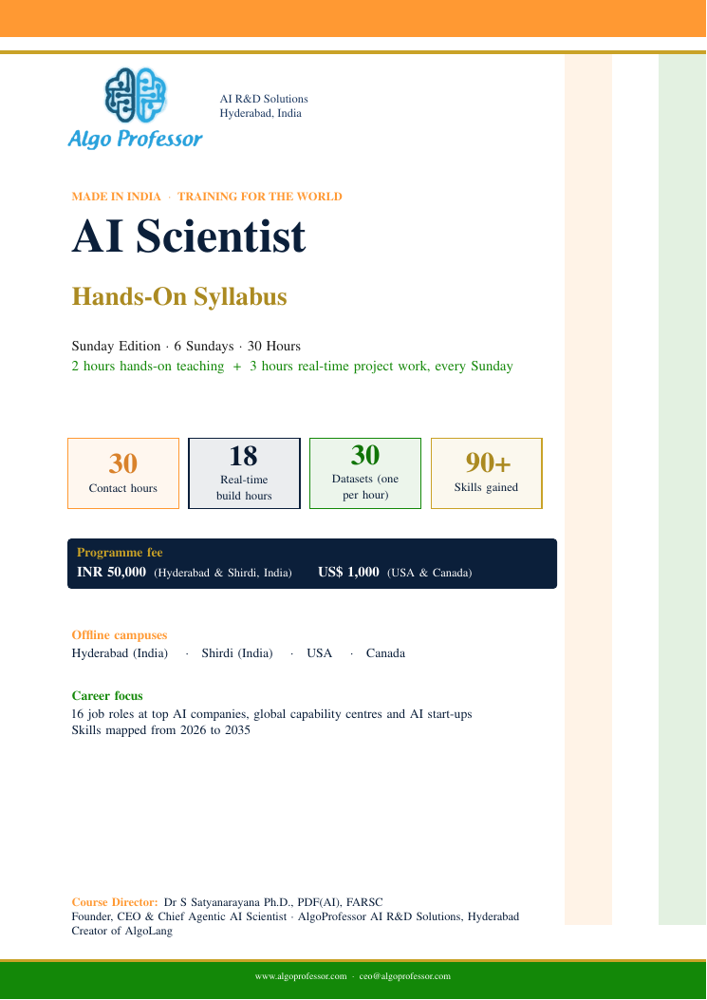
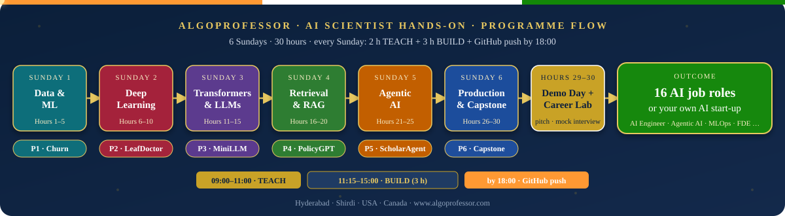
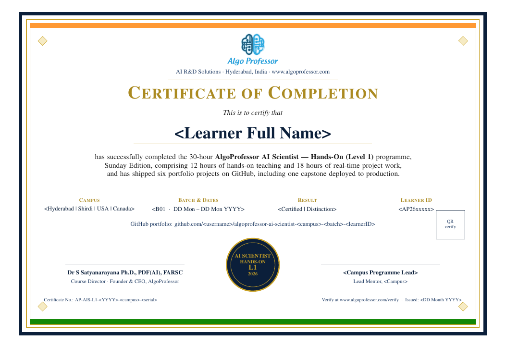

<div align="center">


# AlgoProfessor AI Scientist — Hands-On Programme

**Sunday Edition · 6 Sundays · 30 Hours · Offline in Hyderabad · Shirdi · USA · Canada**

*2 hours hands-on teaching + 3 hours real-time project work, every Sunday*




🌐 **[Visit the course website](https://drssnaiml1-cell.github.io/algoprofessor-ai-scientist/)** · 📄 **[Download the full syllabus (PDF)](syllabus/AlgoProfessor_AI_Scientist_Syllabus.pdf)** · 🧾 **[LaTeX source](syllabus/AlgoProfessor_AI_Scientist_Syllabus.tex)**

</div>

---

## Contents
0. [Sunday-by-Sunday course materials](#-sunday-by-sunday-course-materials)
1. [Course at a glance](#1-course-at-a-glance)
2. [Programme fee](#2-programme-fee)
3. [Sunday timetable](#3-sunday-timetable)
4. [Hour-by-hour syllabus](#4-hour-by-hour-syllabus)
5. [Skills you gain](#5-skills-you-gain)
6. [Jobs you can target](#6-jobs-you-can-target)
7. [AI skill roadmap 2026–2035](#7-ai-skill-roadmap-20262035)
8. [GitHub submission policy (18:00 every Sunday)](#8-github-submission-policy-1800-every-sunday)
9. [Assessment and certificate](#9-assessment-and-certificate)
10. [Campuses and enrolment](#10-campuses-and-enrolment)

---

## 1. Course at a glance

| | |
|---|---|
| **Programme** | AlgoProfessor AI Scientist — Hands-On (Level 1), Sunday Edition |
| **Format** | Offline, classroom + lab, Sundays only |
| **Duration** | 6 Sundays × 5 hours = **30 contact hours** |
| **Weekly split** | 🟨 2 h hands-on teaching + 🟦 3 h real-time project work |
| **Batch size** | Max 30 learners per campus, 1 mentor per 10 learners in build hours |
| **Who it is for** | Final-year B.Tech/M.Tech/MCA/M.Sc students, working engineers moving into AI, researchers, founders |
| **Outcome** | 6 GitHub portfolio projects, 1 deployed capstone, Demo Day pitch, mock-interview report |
| **Certificate** | *AlgoProfessor Certified AI Scientist — Hands-On (Level 1)* |

<p align="center"></p>

## 2. Programme fee

| Campus | Fee per learner |
|---|---|
| 🇮🇳 Hyderabad, India | **INR 50,000** |
| 🇮🇳 Shirdi, India | **INR 50,000** |
| 🇺🇸 USA | **US$ 1,000** |
| 🇨🇦 Canada | **US$ 1,000** |

## 3. Sunday timetable

Same structure at every campus, in local time.

| Time | Mode | Block |
|---|---|---|
| 09:00 – 10:00 | 🟨 TEACH | Hour 1 — concept + live coding |
| 10:00 – 11:00 | 🟨 TEACH | Hour 2 — concept + live coding |
| 11:00 – 11:15 | — | Tea break |
| 11:15 – 12:15 | 🟦 BUILD | Hour 3 — real-time build sprint 1 |
| 12:15 – 13:00 | — | Lunch |
| 13:00 – 14:00 | 🟦 BUILD | Hour 4 — real-time build sprint 2 |
| 14:00 – 15:00 | 🟦 BUILD | Hour 5 — build sprint 3, demo and mentor review |
| **by 18:00** | 🟧 **GIT** | **Mandatory GitHub submission** of the day's project |

**Before Sunday 1:** Python basics (a 4-hour primer is sent on enrolment), a laptop with 16 GB RAM recommended, and GitHub, Hugging Face and Kaggle accounts. Tool stack: Python 3.11+, VS Code, Jupyter, Git, Docker.

## 📚 Sunday-by-Sunday course materials

Every Sunday has **student notes**, **Beamer slides** (PDF + LaTeX source) and a **Jupyter notebook that has already been run**, so you can read the real outputs before running it yourself.

| Sunday | Topic | Notes | Slides | Notebook | Project |
|---|---|---|---|---|---|
| 🟢 1 | [Data & ML Foundations](sunday-01-data-ml/) | [PDF](sunday-01-data-ml/notes/S01_Notes.pdf) · [tex](sunday-01-data-ml/notes/S01_Notes.tex) | [PDF](sunday-01-data-ml/slides/S01_Slides.pdf) · [tex](sunday-01-data-ml/slides/S01_Slides.tex) | [ipynb](sunday-01-data-ml/notebooks/S01_Data_ML_Foundations.ipynb) · [Colab](https://colab.research.google.com/github/drssnaiml1-cell/algoprofessor-ai-scientist/blob/main/sunday-01-data-ml/notebooks/S01_Data_ML_Foundations.ipynb) | P1 Churn Intelligence |
| 🔴 2 | [Deep Learning with PyTorch](sunday-02-deep-learning/) | [PDF](sunday-02-deep-learning/notes/S02_Notes.pdf) · [tex](sunday-02-deep-learning/notes/S02_Notes.tex) | [PDF](sunday-02-deep-learning/slides/S02_Slides.pdf) · [tex](sunday-02-deep-learning/slides/S02_Slides.tex) | [ipynb](sunday-02-deep-learning/notebooks/S02_Deep_Learning_PyTorch.ipynb) · [Colab](https://colab.research.google.com/github/drssnaiml1-cell/algoprofessor-ai-scientist/blob/main/sunday-02-deep-learning/notebooks/S02_Deep_Learning_PyTorch.ipynb) | P2 LeafDoctor |
| 🟣 3 | [Transformers & LLM Engineering](sunday-03-transformers-llm/) | [PDF](sunday-03-transformers-llm/notes/S03_Notes.pdf) · [tex](sunday-03-transformers-llm/notes/S03_Notes.tex) | [PDF](sunday-03-transformers-llm/slides/S03_Slides.pdf) · [tex](sunday-03-transformers-llm/slides/S03_Slides.tex) | [ipynb](sunday-03-transformers-llm/notebooks/S03_Transformers_LLM_Engineering.ipynb) · [Colab](https://colab.research.google.com/github/drssnaiml1-cell/algoprofessor-ai-scientist/blob/main/sunday-03-transformers-llm/notebooks/S03_Transformers_LLM_Engineering.ipynb) | P3 MiniLLM |
| 🟩 4 | [Embeddings, Retrieval & RAG](sunday-04-retrieval-rag/) | [PDF](sunday-04-retrieval-rag/notes/S04_Notes.pdf) · [tex](sunday-04-retrieval-rag/notes/S04_Notes.tex) | [PDF](sunday-04-retrieval-rag/slides/S04_Slides.pdf) · [tex](sunday-04-retrieval-rag/slides/S04_Slides.tex) | [ipynb](sunday-04-retrieval-rag/notebooks/S04_Retrieval_RAG.ipynb) · [Colab](https://colab.research.google.com/github/drssnaiml1-cell/algoprofessor-ai-scientist/blob/main/sunday-04-retrieval-rag/notebooks/S04_Retrieval_RAG.ipynb) | P4 PolicyGPT |
| 🟠 5 | [Agentic AI Systems](sunday-05-agentic-ai/) | [PDF](sunday-05-agentic-ai/notes/S05_Notes.pdf) · [tex](sunday-05-agentic-ai/notes/S05_Notes.tex) | [PDF](sunday-05-agentic-ai/slides/S05_Slides.pdf) · [tex](sunday-05-agentic-ai/slides/S05_Slides.tex) | [ipynb](sunday-05-agentic-ai/notebooks/S05_Agentic_AI_Systems.ipynb) · [Colab](https://colab.research.google.com/github/drssnaiml1-cell/algoprofessor-ai-scientist/blob/main/sunday-05-agentic-ai/notebooks/S05_Agentic_AI_Systems.ipynb) | P5 ScholarAgent |
| 🔵 6 | [Production, Responsible AI & Capstone](sunday-06-production-capstone/) | [PDF](sunday-06-production-capstone/notes/S06_Notes.pdf) · [tex](sunday-06-production-capstone/notes/S06_Notes.tex) | [PDF](sunday-06-production-capstone/slides/S06_Slides.pdf) · [tex](sunday-06-production-capstone/slides/S06_Slides.tex) | [ipynb](sunday-06-production-capstone/notebooks/S06_Production_Responsible_AI.ipynb) · [Colab](https://colab.research.google.com/github/drssnaiml1-cell/algoprofessor-ai-scientist/blob/main/sunday-06-production-capstone/notebooks/S06_Production_Responsible_AI.ipynb) | P6 Capstone |

```bash
pip install -r requirements.txt          # Python packages for all notebooks
./build_materials.sh                      # rebuild every notes/slides PDF (TeX Live)
```
Datasets download automatically into `data/` the first time a notebook runs (UCI Adult, California Housing, IBM Telco, Fashion-MNIST, CIFAR-10, PlantVillage, Tiny Shakespeare, SST-2, TruthfulQA, GSM8K).

## 4. Hour-by-hour syllabus

### 🟢 Sunday 1 — Data & Machine Learning Foundations (Hours 1–5)
| Hr | Mode | Topic | Dataset | Skills |
|---|---|---|---|---|
| 1 | TEACH | Scientific Python, NumPy, Pandas, EDA | UCI Adult Income | NumPy, Pandas, data cleaning, EDA |
| 2 | TEACH | ML pipeline, cross-validation, gradient boosting | California Housing | scikit-learn Pipelines, CV, XGBoost/LightGBM |
| 3 | BUILD | Churn project: problem framing, baseline | IBM Telco Customer Churn | Problem framing, metric selection |
| 4 | BUILD | Class imbalance, Optuna tuning, SHAP | IBM Telco Customer Churn | Optuna, SMOTE, SHAP |
| 5 | BUILD | MLflow tracking, GitHub, stakeholder demo | Telco + MLflow runs | MLflow, Git, storytelling |

**Deliverable P1 — *Churn Intelligence***

### 🔴 Sunday 2 — Deep Learning with PyTorch (Hours 6–10)
| Hr | Mode | Topic | Dataset | Skills |
|---|---|---|---|---|
| 6 | TEACH | Tensors, autograd, training loops, MLPs | Fashion-MNIST | PyTorch core, optimisers |
| 7 | TEACH | CNNs, augmentation, transfer learning | CIFAR-10 | CNNs, transfer learning, mixed precision |
| 8 | BUILD | Crop-disease detector: data pipeline | PlantVillage | DataLoaders, leakage checks |
| 9 | BUILD | Fine-tune EfficientNet/ViT, Grad-CAM | PlantVillage | ViT, Grad-CAM, error analysis |
| 10 | BUILD | Field-photo robustness, quantisation, ONNX | PlantVillage + field photos | ONNX, quantisation, model cards |

**Deliverable P2 — *LeafDoctor***

### 🟣 Sunday 3 — Transformers & LLM Engineering (Hours 11–15)
| Hr | Mode | Topic | Dataset | Skills |
|---|---|---|---|---|
| 11 | TEACH | Self-attention from scratch, BPE, mini-GPT | Tiny Shakespeare | Attention, tokenisers, GPT internals |
| 12 | TEACH | Hugging Face fine-tuning | IMDb / SST-2 | HF Transformers, Trainer |
| 13 | BUILD | LoRA/QLoRA instruction-tuning a small open LLM | databricks-dolly-15k | PEFT, LoRA, chat templates |
| 14 | BUILD | LLM evaluation, contamination checks | MMLU subset + held-out Dolly | LLM evals, benchmark hygiene |
| 15 | BUILD | Serving with vLLM/Ollama, structured outputs | Team prompt suite | Inference serving, cost/latency |

**Deliverable P3 — *MiniLLM***

### 🟩 Sunday 4 — Embeddings, Retrieval & RAG (Hours 16–20)
| Hr | Mode | Topic | Dataset | Skills |
|---|---|---|---|---|
| 16 | TEACH | Embeddings, vector DBs, ANN indexes | arXiv Metadata (50k subset) | FAISS, Chroma, pgvector, HNSW |
| 17 | TEACH | Hybrid search, re-ranking, retrieval metrics | BEIR SciFact | BM25 + dense, re-rankers, nDCG |
| 18 | BUILD | Policy assistant: PDF ingestion and chunking | NEP 2020 + UGC/AICTE PDFs | PDF parsing, chunking |
| 19 | BUILD | Cited Q&A API with abstention | Same corpus | FastAPI, citation grounding |
| 20 | BUILD | RAGAS evaluation on a golden set | Team golden Q&A (100) | Hallucination measurement |

**Deliverable P4 — *PolicyGPT***

### 🟠 Sunday 5 — Agentic AI Systems (Hours 21–25)
| Hr | Mode | Topic | Dataset | Skills |
|---|---|---|---|---|
| 21 | TEACH | Function calling, ReAct, MCP | HotpotQA | Tool use, MCP servers |
| 22 | TEACH | LangGraph multi-agent, guardrails (AlgoLang preview) | GSM8K | Planner–executor–critic, memory |
| 23 | BUILD | AI Research Scientist Agent | arXiv + Semantic Scholar APIs | API tools, citation tracking |
| 24 | BUILD | Sandboxed code-execution agent | UCI dataset (team choice) | Docker sandboxing, reproducibility |
| 25 | BUILD | Agent evals, tracing, human approval | GAIA validation subset | Langfuse/LangSmith, cost control |

**Deliverable P5 — *ScholarAgent***

### 🔵 Sunday 6 — Production, Responsible AI & Capstone Demo Day (Hours 26–30)
| Hr | Mode | Topic | Dataset | Skills |
|---|---|---|---|---|
| 26 | TEACH | Docker, CI/CD, drift monitoring | NYC TLC Taxi Trips | GitHub Actions, Evidently |
| 27 | TEACH | Responsible AI: fairness, red-teaming, EU AI Act, DPDP Act 2023 | UCI Adult + TruthfulQA | Fairlearn, AI governance |
| 28 | BUILD | Capstone hardening and cloud deployment | Learner's capstone data | Cloud deploy, testing, audit |
| 29 | BUILD | **Demo Day** — 7-minute pitch to industry panel | Live demo | Technical pitching |
| 30 | BUILD | Career Lab: mock interviews, portfolio review | Interview question bank | Interview performance |

**Deliverable P6 — *Capstone in Production***

## 5. Skills you gain

**94 hands-on skills in 10 clusters**, each practised in a timed course hour.

| Cluster | Skills | Example skills |
|---|---:|---|
| Programming & Maths | 10 | Python, NumPy, Git, linear algebra, probability |
| Data & Classical ML | 10 | EDA, scikit-learn, XGBoost, Optuna, SHAP, MLflow |
| Deep Learning & Vision | 11 | PyTorch, CNNs, ViT, Grad-CAM, ONNX, quantisation |
| LLM & Generative AI | 10 | Attention, LoRA/QLoRA, vLLM, LLM evaluation |
| Retrieval & RAG | 11 | Embeddings, vector DBs, hybrid search, RAGAS |
| Agentic AI | 11 | Function calling, MCP, LangGraph, guardrails, agent evals |
| MLOps & Cloud | 8 | FastAPI, Docker, CI/CD, drift monitoring |
| Responsible AI & Ethics | 8 | Fairness metrics, red-teaming, AI audits, AI regulation |
| Research | 7 | Paper reading, reproduction, experiment design |
| Professional & Founder | 8 | Problem framing, pitching, product thinking |

## 6. Jobs you can target

Entry-level and junior roles are the realistic first target.

| Job role | Proof projects |
|---|---|
| AI Engineer | P3, P4, P5 |
| Machine Learning Engineer | P1, P2, P6 |
| LLM / GenAI Engineer | P3 |
| Agentic AI Engineer | P5 |
| RAG / Search Engineer | P4 |
| Forward Deployed Engineer | P4, P6 |
| Data Scientist | P1 |
| Computer Vision Engineer | P2 |
| MLOps Engineer | P6 |
| AI Research Engineer | P3, P5 |
| Applied Scientist (junior) | P3, P4 |
| Responsible AI Analyst | P6 |
| AI Product Engineer | P4, P6 |
| AI Solutions Architect (junior) | P4, P5, P6 |
| AI Trainer / Educator | Demo Day |
| AI Start-up Founder | P6 |

**Where these jobs are:** top AI labs and big tech, global capability centres (Hyderabad, Pune, Bengaluru), AI start-ups in India, the USA and Canada, IT services and consulting firms, product companies (fintech, health, agri, ed-tech), and university research labs.

## 7. AI skill roadmap 2026–2035

| Period | Skill wave | Roles in demand |
|---|---|---|
| **2026–27** | Agentic AI & LLM engineering *(covered in this course)* | AI Engineer, Agent Engineer, Forward Deployed Engineer |
| **2028–29** | Multimodal & embodied AI | Multimodal ML Engineer, Robotics AI Engineer |
| **2030–31** | AI for science & autonomous research | AI Research Scientist, AI-for-Science Lead |
| **2032–33** | Efficient, edge & new-compute AI | Edge AI Engineer, Green AI Engineer, Quantum ML Researcher |
| **2034–35** | Trustworthy advanced AI & governance | AI Safety Researcher, AI Auditor, Chief AI Officer |

> Later periods are projections from current research trends, not certainties.

## 8. GitHub submission policy (18:00 every Sunday)

> **Rule:** every learner submits that Sunday's project on GitHub **by 18:00 local time on the same Sunday**.

**Repository name** (one public repo per learner, used for all six Sundays):
```
algoprofessor-ai-scientist-<campus>-<batch>-<learnerID>
e.g. algoprofessor-ai-scientist-hyd-b01-AP2601023     (hyd | sdi | usa | can)
```

**Structure**
```
algoprofessor-ai-scientist-.../
├── README.md            # portfolio index
├── LICENSE              # MIT or Apache-2.0
├── .gitignore
├── P1-churn-intelligence/
│   ├── README.md        # project report
│   ├── requirements.txt
│   ├── notebooks/  src/  results/  docs/
│   └── data/README.md   # dataset links only
├── P2-leafdoctor/
├── P3-minillm/
├── P4-policygpt/
├── P5-scholaragent/
└── P6-capstone/
```

**Each project README must include:** problem statement, dataset (with source and licence), method, results, how to run, limitations and ethics, AI-assistant use disclosure, and author details.

**Submission steps**
```bash
# 1. commit as you work (at least 3 meaningful commits during the build hours)
git commit -m "feat(P2): add Grad-CAM visualisation"
# 2. clean up, update requirements.txt and README
# 3. push
git push origin main
# 4. tag the release
git tag -a sunday-2 -m "Sunday 2 submission"
git push origin sunday-2
# 5. create a GitHub Release from the tag
# 6. submit the release link + commit hash on the AlgoProfessor submission form before 18:00
```

**Never commit** API keys or passwords (use `.env` and list it in `.gitignore`), raw datasets or files larger than 50 MB, personal data, or uncredited code.

| Submitted | Effect on that project's marks |
|---|---|
| By 18:00 Sunday | Full marks available |
| 18:01 – 23:59 Sunday | 10% deduction |
| Monday – Wednesday | 25% deduction |
| After Wednesday or not tagged | Not graded |

## 9. Assessment and certificate

| Component | Weight |
|---|---:|
| Weekly deliverables P1–P5 submitted on GitHub by 18:00 | 50% |
| Capstone P6 (deployment, audit, Demo Day pitch) | 30% |
| Hour-5 mentor reviews and peer code reviews | 10% |
| Career Lab mock interview | 10% |

**Certified** at 60% overall and 5 of 6 Sundays attended · **Distinction** at 85%.

<div align="center">

</div>

> **An honest note on outcomes.** Thirty hours gives a strong, portfolio-backed start. Offers from top AI companies and funded start-ups also depend on sustained practice and work you keep building after the course. AlgoProfessor gives mentoring and referrals where it can, but does not guarantee placement.

## 10. Campuses and enrolment

| Campus | Day & time | Fee |
|---|---|---|
| Hyderabad, India | Sundays, 09:00–15:00 IST | INR 50,000 |
| Shirdi, India | Sundays, 09:00–15:00 IST | INR 50,000 |
| USA | Sundays, 09:00–15:00 local (city announced per batch) | US$ 1,000 |
| Canada | Sundays, 09:00–15:00 local (city announced per batch) | US$ 1,000 |

**Applications:** cto@algoprofessor.com · **Director:** ceo@algoprofessor.com · **Web:** [www.algoprofessor.com](https://www.algoprofessor.com)

---

### Course Director
**Dr S Satyanarayana Ph.D., PDF(AI), FARSC**  
Founder, CEO & Chief Agentic AI Scientist · AlgoProfessor AI R&D Solutions, Hyderabad  
Creator of AlgoLang

### Build the syllabus PDF
```bash
cd syllabus
pdflatex AlgoProfessor_AI_Scientist_Syllabus.tex
pdflatex AlgoProfessor_AI_Scientist_Syllabus.tex   # second run for page references
```

<div align="center"><sub>© 2026 AlgoProfessor AI R&D Solutions, Hyderabad. All rights reserved.</sub></div>
